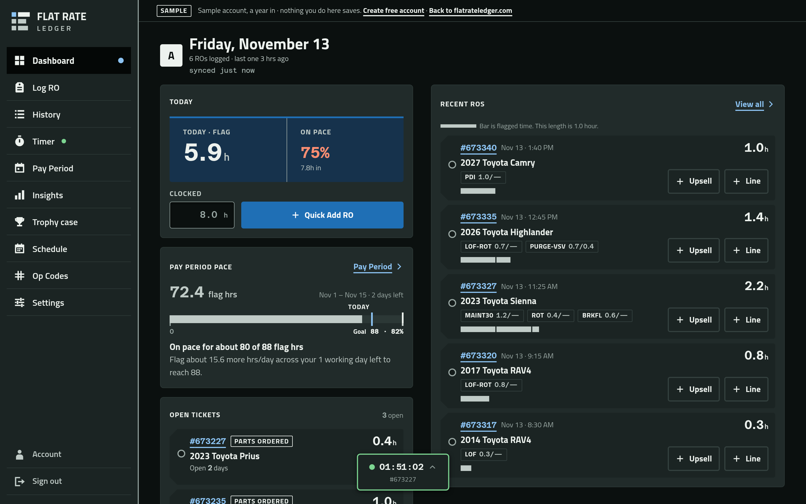
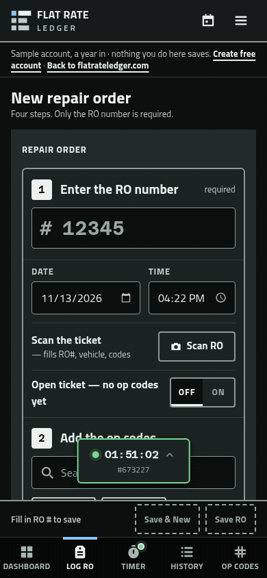
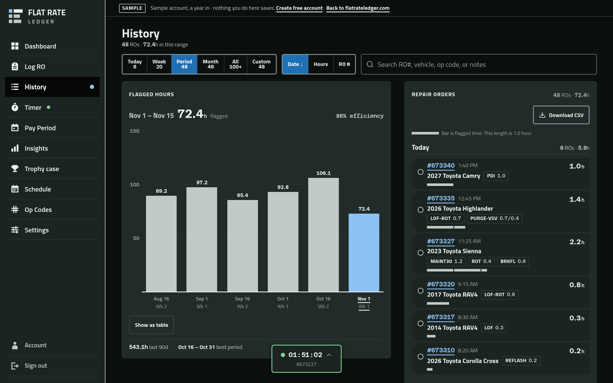
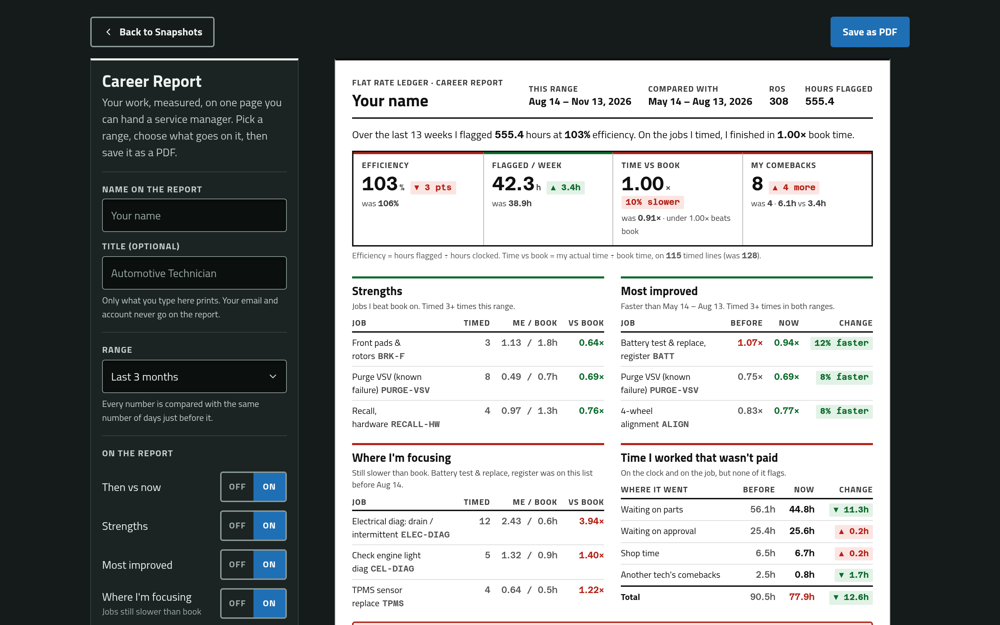

# Flat Rate Ledger

**A pay record for flat-rate automotive technicians.** Log every repair order on your phone, watch your pay period in real time, and catch a shorted paycheck before payday.

Built and run by a working flat-rate technician in California.

[**Live site**](https://flatrateledger.com) · [**Try the demo, no account needed**](https://demo.flatrateledger.com) · Source code: private (live product with real users)

---

## The problem

Flat-rate technicians are paid by the job, not by the hour. Every repair has a book time, and the tech is paid that time whether the job takes longer or shorter. The shop keeps the only official record of what was flagged. Most techs keep no record of their own.

So when hours go missing from a paycheck, the tech has nothing to push back with.

## Who built it

I'm a flat-rate technician, and I taught myself to code to build the tool I wanted at work: my own record of my work, one no employer controls.

I wanted to build something that directly supports technicians and the way they actually work, day to day: on their feet, between jobs, with a phone in their pocket and no time to spare. Every feature has to earn its place in that setting.

I run my own homelab, so I hosted Flat Rate Ledger there in production myself before officially moving it to the cloud. Running it on my own hardware taught me what keeping a live service healthy really takes: backups, monitoring, recovering from outages. Those habits came with it to the cloud.

I designed it, built it, and run it on my own. A small group of technicians at and around my shop use it.

## What it does

**Log a repair order in seconds.** It's built for a phone in the bay, often with gloves on: type the RO number, tap the op codes, save. Or photograph the ticket and let the app fill in the RO number, vehicle and codes.

**Know where your pay period stands.** Live pace against your goal, flagged vs. clocked hours, efficiency, and what the check should come to.

**Prove a short check.** When the paystub comes in, line it up against your own record. Anything missing becomes a printable *Flagged vs. Paid Variance Report* to take to the service manager.

**Track the time nobody pays for.** Comebacks, waiting on parts, waiting on approval. Three job timers run at once, and unpaid time adds up in its own ledger, so it doesn't just disappear.

**See your year.** History by day, week and pay period. Insights across every period. A one-page *Career Report* you can hand to a service manager.

**Stay with it.** A schedule for logging actual hours worked, trophies and personal records, and op-code mastery as your history grows.

| History | Career Report |
|---|---|
|  |  |

### What's next: True Time

Every job a tech times becomes an anonymous data point: how long the work really takes, next to what it pays. Pooled across many techs, that's data technicians have never had. Collection is live, with opt-in and strict privacy rules. The shared view opens once there's enough data to be honest.

## By the numbers

<!-- numbers:start -->
| | |
|---|---|
| Building since | April 2026 |
| Commits | 580+ |
| Automated tests | 3,000+ across 227 files |
| Database migrations | 60, every one replayed in CI |
| Pages and screens | 43 |
| Checks every release must pass | 7 |

Figures refreshed November 13, 2026 from the private repository.
<!-- numbers:end -->

## Tech stack

| Layer | What I use |
|---|---|
| App | Next.js (App Router, Server Components, Server Actions), React, TypeScript, Tailwind CSS |
| Data | Supabase: Postgres with row-level security on every table, Auth (email + Google), Storage, Edge Functions |
| Hosting | Vercel |
| Testing | Vitest (unit and logic), Playwright (visual regression, smoke tests, nightly QA) |
| CI/CD | GitHub Actions + Vercel Deployment Checks |
| Monitoring | Sentry (errors), Better Stack (uptime and alerts) |
| Operations | n8n (automation), Backblaze B2 (off-site backups), Resend (email) |

## How it's engineered

Real people trust this app with their pay records, so most of the work goes into making sure a mistake never reaches them.

- **Every release has to pass 7 checks before anyone sees it.** A merge builds the new version and holds it. It only goes live after type checks, tests, lint, a visual check, database checks and two smoke tests pass. After release, one more check runs against the live site and rolls back automatically if it fails. → [Release pipeline](media/diagrams/release-pipeline.md)
- **A visual check photographs every page before each release:** phone and desktop, dark and light. It runs on frozen sample data and a frozen clock, so a difference means the code changed, not the data.
- **Tests that write, not just read.** Almost every serious bug I've found was in *saving* something, not in showing it. The smoke tests sign in and save real records.
- **The database protects itself.** Row-level security on every table means one tech can never see another tech's records, even if the app code has a bug.
- **Backups I don't have to trust.** Encrypted, off-site backups every 6 hours, locked against deletion. The server that makes them can't read them.
- **One email a morning.** A QA bot uses the app every night like a real tech. Health checks, backups, uptime and errors all write down their results, and a 6 AM digest shows only what needs me. A quiet morning is four lines.
- **I moved it to the cloud without losing anything.** Flat Rate Ledger started on a server I ran at home. In October 2026 I moved it to Vercel and Supabase Cloud with a rehearsed cutover, and every record came across intact.

### Go deeper

- [**Architecture**](docs/architecture.md): the stack, how data moves, the security model, environments
- [**Engineering practices**](docs/engineering-practices.md): testing layer by layer, database changes, releases, with code excerpts
- [**Operations**](docs/operations.md): the morning digest, backups, the nightly QA bot, monitoring
- [**Product decisions**](docs/product-decisions.md): the calls that shaped the app, and why
- [**Where it's going**](docs/roadmap.md): True Time and what's next

## How I build

I build Flat Rate Ledger with AI coding assistants, the way a shop uses good diagnostic equipment. The scan tool doesn't fix the car; the tech does.

**It starts on the shop floor.** I take real problems I run into at work and turn them into features. I also listen to other techs: what they wish they had, and what gets in their way during a shift. Their feedback, plus the bug reports and feature requests sent from inside the app, is what starts every design loop.

**Then I design and decide.** I work out how each feature should behave, then push on the edge cases until the design holds up: the RO that spans two days, the paycheck that comes in short, the shop that reuses RO numbers. I decide what ships and what waits.

**Then I verify.** I review what ships and test it on my own pay before anyone else uses it. The checks above exist because I don't take any code on faith, whoever wrote it. That's the same rule as in the shop: you don't sign off on a repair until you've road-tested it.

## Why the source is private

Flat Rate Ledger is an active, growing product, not a finished class project. Technicians keep their real pay records in it, and keeping the code closed is part of how I protect them and the product itself. This repository shows what it does and how it's built, without handing over the product.

---

© 2026 Flat Rate Ledger. All rights reserved. Screenshots show the public demo account's sample data.
