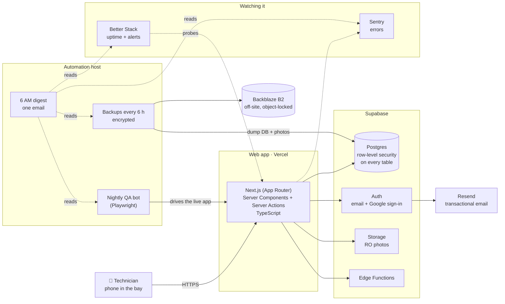

# Architecture

How Flat Rate Ledger is put together, and why each piece is there.

## The design constraint: a phone in the bay

Everything starts from where the app is used. A technician opens it on a phone, in the shop, between jobs, often with gloves on, for a few seconds at a time. That rules a lot out:

- **No heavy client.** Pages render on the server and arrive ready to read. The phone does very little work, which matters on a weak signal at the back of a shop.
- **Big targets, few steps.** Logging an RO takes the RO number and a few taps. Every touch target is at least 44 px, and an automated check fails the release if one isn't.
- **Readable under shop lights.** Dark and light themes are both first-class, and both are checked on every release.

## The stack

| Layer | Choice | Why |
|---|---|---|
| Framework | **Next.js** (App Router), **React**, **TypeScript** | Server Components render data on the server; Server Actions handle every write without a hand-built API layer. TypeScript catches the mistakes I would otherwise find at work. |
| Styling | **Tailwind CSS** + design tokens | One token file defines color, spacing and type for both themes, so a change lands everywhere at once. |
| Database | **Postgres** on **Supabase** | Relational data (repair orders → op-code lines → pay periods) and row-level security built into the database itself. |
| Auth | **Supabase Auth** | Email and Google sign-in. Sessions live in secure cookies the server reads. |
| Files | **Supabase Storage** | Photos of repair-order tickets, private per user. |
| Hosting | **Vercel** | Every pull request gets a preview against a staging database; production releases are held until checks pass. |
| Validation | **Zod** | Every form and import is parsed into a known shape before it touches the database. |

## How data moves

1. **Reading.** A page is a Server Component. It asks the data layer for what it needs, and the data layer queries Postgres *as the signed-in user*. The database applies row-level security, so a query can only ever see that user's rows.
2. **Writing.** A form calls a Server Action. The action validates the input with Zod, writes through the same data layer, then tells Next.js which pages to refresh.
3. **Undo.** Destructive or bulk changes, like moving a repair order's lines to another day, record what they changed so the user can undo them in one tap.

There is one data layer (`lib/db/`) between the app and the database. Pages never write SQL or call the database directly, so a rule like "repair-order numbers are not unique" lives in exactly one place.

## Security model

The database is the last line of defense, not the app code.

- **Row-level security on every table.** Each table has a policy that limits every read and write to the owner's rows.
- **Column-level grants where a row isn't enough.** A row policy decides *which rows* you can change, not *which columns*. Settings rows hold user preferences next to fields users must never set themselves, so those tables grant UPDATE only on the specific columns users may change. → [Snippet: locking a column](engineering-practices.md#snippet-2-row-security-isnt-column-security)
- **Least privilege by default.** Database roles the app uses can't truncate tables or create triggers, and the default for future tables is changed too, so a new table can't quietly bring the privilege back.
- **Migrations prove themselves.** A security migration ends with a check that queries the database catalog and fails if the privilege it removed is still there. A migration that does nothing should not look like one that worked.

## Environments

| Environment | Database | Who uses it |
|---|---|---|
| Local development | Staging | Me. The app refuses to start in development mode against production. |
| Preview (every pull request) | Staging | Reviewing a change on a real URL before it merges |
| Production | Production | Technicians |
| Demo | Sample data in memory | Anyone. [demo.flatrateledger.com](https://demo.flatrateledger.com) is the same app in sample mode: a year of a sample tech's work, and nothing a visitor does is saved. |
| Visual canary (CI) | Frozen sample data and a frozen clock | The release pipeline. See [engineering practices](engineering-practices.md#the-visual-canary). |

The demo and the visual canary are the *same build* as production, switched into sample mode at runtime. That is deliberate: the build that passes the checks is byte-for-byte the build that ships.

## Where it started

Flat Rate Ledger first ran in production on my own homelab: a Proxmox virtual machine running the app and a self-hosted Supabase stack in Docker, behind a reverse proxy. In October 2026 I moved it to Vercel and Supabase Cloud. The homelab still runs the automation around the app: backups, the nightly QA bot and the morning digest. See [operations](operations.md).
