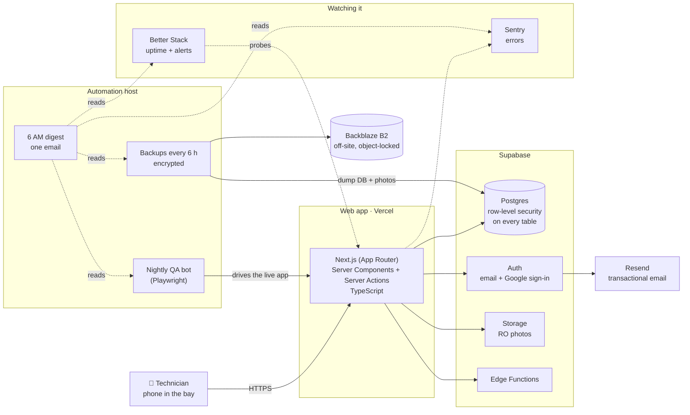

# Architecture

**Why this shape**

- **Server-side by default.** Pages render on the server and writes go through Server Actions, so the browser never holds database credentials and the phone does little work on a slow shop connection.
- **Security lives in the database.** Every table has row-level security, so a bug in the app code still can't show one technician another technician's records.
- **One email a day.** Health checks, the QA bot, backups and error tracking each write their results down. A single morning digest reads all of them and shows only what needs attention.
