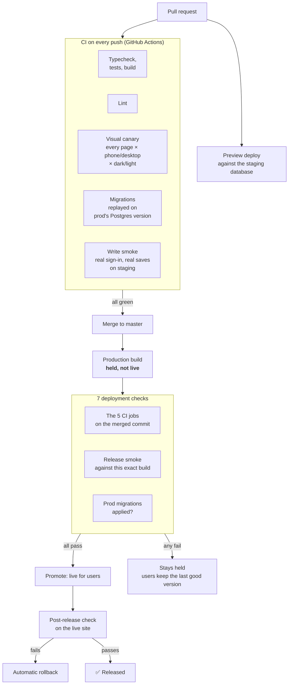

# Release pipeline

Every merge to `master` ships to real users, so nothing reaches them until it has passed seven checks.

**Why it's built this way**

- **The visual canary runs on frozen data and a frozen clock.** Live data made the screenshots change every night, and a check that fails for no reason gets ignored. With both frozen, nothing needs masking: the numbers and charts are compared for real.
- **The smoke test writes.** Pages that only load prove little; almost every real bug was in saving something. The smoke test signs in and saves records.
- **Database changes are applied by hand, on purpose.** A release that needs a migration waits, held, until the migration is applied. The new code never runs against an old schema.
